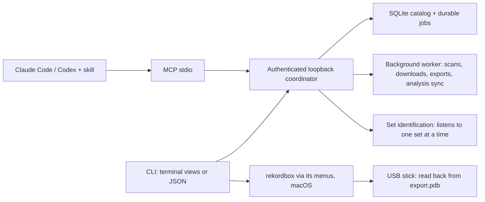

# Contributing

Start with [status](docs/STATUS.md), [architecture](docs/ARCHITECTURE.md), and the [product plan](PLAN.md). This is an experimental local engine; useful improvements should advance an actual DJ or assistant workflow.

## Architecture



One coordinator owns a workspace and exits after 30 idle minutes when it was started implicitly. Recordings, immutable byte revisions, file locations and collection membership are separate entities, so a renamed or retagged file never silently changes a crate. Read the [architecture](docs/ARCHITECTURE.md), the [CLI/API contract](docs/CONTRACT.md), [coverage](docs/COVERAGE.md) and the [product plan](PLAN.md). The MCP server and skill are described in [agent setup](docs/AGENTS.md).

## Development

Requires Python 3.12+ and uv; FFmpeg/ffprobe for compressed audio; the optional `download` extra for yt-dlp. On Python 3.12, add `--extra recognize` for Shazam listening (shazamio), as the installer and CI's 3.12 jobs do; `uv run python scripts/check_recognition.py` checks it without asking Shazam anything.

```bash
git clone https://github.com/uneasymusings/dj-library-tool.git && cd dj-library-tool
uv sync --locked --extra download
uv run pytest -q
uv run ruff check src scripts tests
uv run ruff format --check src scripts tests
uv build
```

Prefix any `djlib` command with `uv run` to run your checkout. CI runs tests, lint, formatting and packaging on Linux, macOS and Windows with Python 3.12 and 3.13 (song recognition installed and checked on 3.12); tagged releases are built and checked before publishing. See [validation](docs/VALIDATION.md) and [security](SECURITY.md).

Use a separate initialized workspace and synthetic or appropriately licensed media. Never commit personal paths, workspace databases, credentials, source downloads, or copyrighted audio fixtures. The built-in demo generates original tones.

## Design conventions

- Keep business behavior in application/worker modules, with thin CLI and MCP adapters.
- Use strict versioned request contracts and typed failures; avoid hidden interactive prompts.
- Persist intent before expensive work. Keep database transactions short and all slow I/O outside them.
- Preserve semantic idempotency and distinguish acceptance, partial completion, app import, and device readiness.
- Treat source metadata as untrusted data. Preserve provenance and recording/version evidence.
- Use comments for operational invariants and non-obvious tradeoffs; let ordinary names and functions explain straightforward mechanics.
- Document behavioral changes, compatibility limitations, and migration requirements in the same change.
- Write DJ-facing text (README, quick start, terminal views, the review page) in short, plain sentences and DJ words: set, tracklist, crate, playlist, owned, missing, ID, stick. Keep words like envelope, coordinator, revision and workspace internals in developer docs.

Model changes require a new Alembic revision; do not rewrite a migration already used by others. `alembic.ini` targets an ignored development database. Runtime migrations are packaged with the application and receive the coordinator's existing connection.

After changing public request contracts, regenerate the checked-in schemas with `uv run python scripts/export_schemas.py`. The artifact intentionally omits per-call request IDs so generation stays deterministic.

## Sources djlib reads

- **MixesDB:** at most 4 requests per lookup, at least 4 seconds apart across all lookups (its robots.txt `Crawl-delay: 4`), with an honest User-Agent naming djlib, its version and this repository. Its robots.txt also has `Disallow: /*?action=`, which a literal reading applies to the `/w/api.php?action=query` requests djlib makes. Before tagging a release, the owner asks the MixesDB admins whether user-triggered, per-set lookups at this pace are welcome, and records the answer here. If they decline, turn the lookup off by default before tagging. Anyone can turn it off with `DJLIB_MIXESDB=off` (or `0`, `false`, `no`), which `djlib set`, `djlib identify` and the MCP tools all follow; the background service reads it when it starts.
- **1001Tracklists:** never fetched. DJs or their assistants copy the tracklist in a browser.
- **Shazam:** used unofficially, one request at a time from one address, with back-off when it slows down. No address rotation and no parallel listening. AudD and ACRCloud are the licensed options.

## Pull requests and issues

Describe the user scenario, intended behavior, implementation choice, actual validation performed, and outstanding limitations. Report facts observed in a real DJ app separately from assumptions based on a file format.

For bug reports, include OS/Python/app versions, command name, error code, and a redacted item/job outcome. Share a synthetic reproducer where possible. Public logs can contain source paths and URLs; redact those first. Use the private reporting process in [SECURITY.md](SECURITY.md) for vulnerabilities.

Runtime tests use original generated audio, isolated workspaces, controlled source responses, actual CLI processes, and real MCP stdio. FFmpeg-dependent cases skip when the decoder is unavailable. Live providers and signed-in AI hosts belong in separate explicit evaluations, not network-dependent CI. Record versions, observed outcomes, and remaining limits in [validation](docs/VALIDATION.md) and [status](docs/STATUS.md). Do not publish personal host transcripts or music libraries.

## GitHub releases

Update the project, engine, and lockfile version together. Update the pinned wheel URL and `DJLIB_VERSION` example in [installation](docs/INSTALL.md) and the version in the README's alpha note. Run the full checks above, then:

```bash
uv run --locked python scripts/check_distribution.py
uv run --locked python scripts/release_artifacts.py
```

The second script prints the four files to attach: the current wheel, source archive, portable skill ZIP, and `SHA256SUMS`. It excludes older builds and allows only documented skill resources into the standalone ZIP. The wheel bundles the same skill resources.

Commit and push the reviewed changes; confirm all six matrix jobs pass. Tag that exact commit and create a GitHub prerelease with those four assets and release notes describing observed checks and unfinished scope. Do not upload workspace data or test transcripts. Finally install the published wheel URL into a fresh persistent tool environment outside the checkout, create a new demo/session, and verify its CLI/MCP paths point to the installed package. Test the standalone ZIP download and checksum manifest too. Publication alone does not prove the public install works.
