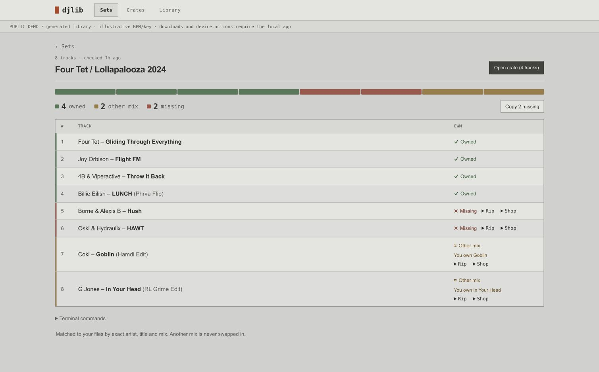
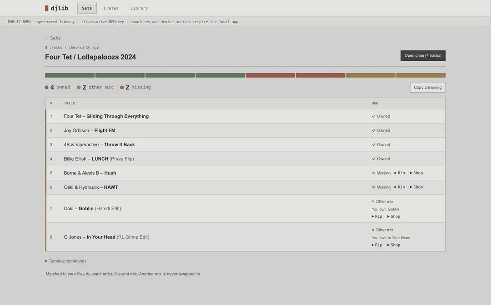
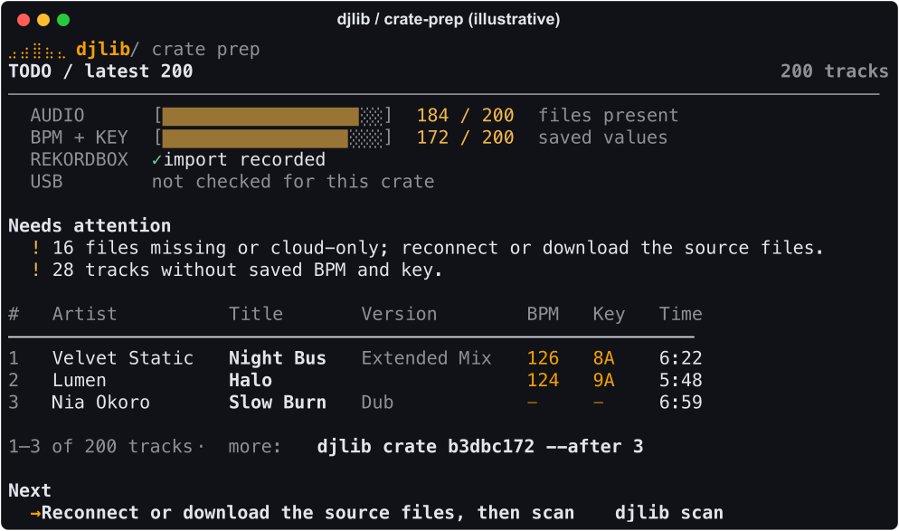

# djlib

[](https://github.com/uneasymusings/dj-library-tool/actions/workflows/quality.yml)

**Paste a set link, get every track. See what you own. Play it from your USB.**

[Try the review-page demo](https://uneasymusings.github.io/dj-library-tool/preview/) · [Install the local tool](#install)

## From tracklist to crate

Follow **Avalon Emerson, Ben UFO, Four Tet, Floating Points, and Skrillex** through the actual terminal: **check the set → inspect the crate**. Real CLI output, edited for pacing, with a generated demo library and illustrative saved BPM/key. [About these examples](docs/images/demo/README.md).

<p align="center">
  <a href="https://github.com/uneasymusings/dj-library-tool/releases/download/v0.1.0a22/gray-demo-avalon-emerson.mp4"></a>
</p>

**Avalon Emerson / 9000Streams.** Exact mixes, missing records, and a crate with a clear next step. [Watch MP4](https://github.com/uneasymusings/dj-library-tool/releases/download/v0.1.0a22/gray-demo-avalon-emerson.mp4) · [Still image](docs/images/demo/avalon-emerson-poster.png) · [Set source](https://www.youtube.com/watch?v=zn-Mpr9CPkc) · [Open this set in the demo](https://uneasymusings.github.io/dj-library-tool/preview/#/sets/request_db35a700d0a1417993a2a99689ff919c)

<details>
<summary><b>Ben UFO</b> — an ID stays an ID; another mix stays out</summary>
<br>


Selected tracks from **Boiler Room London, 21 September 2010**. The demo leaves the two IDs unnamed and keeps the wrong mix out of the crate. [Watch MP4](https://github.com/uneasymusings/dj-library-tool/releases/download/v0.1.0a22/gray-demo-ben-ufo.mp4) · [Still image](docs/images/demo/ben-ufo-poster.png) · [Published tracklist](https://music.apple.com/us/album/boiler-room-ben-ufo-in-london-sep-21-2010-dj-mix/1549936423) · [Open this set in the demo](https://uneasymusings.github.io/dj-library-tool/preview/#/sets/request_a7020bcbf173494cae3a8ba42824a486)
</details>
<details>
<summary><b>Four Tet</b> — a festival tracklist becomes a practical crate</summary>
<br>


Selected tracks from **Lollapalooza 2024**. The original recordings of “Goblin” and “In Your Head” do not substitute for the requested edits. [Watch MP4](https://github.com/uneasymusings/dj-library-tool/releases/download/v0.1.0a22/gray-demo-four-tet.mp4) · [Still image](docs/images/demo/four-tet-poster.png) · [Set source](https://www.youtube.com/watch?v=C2f_OA2Ce14) · [Open this set in the demo](https://uneasymusings.github.io/dj-library-tool/preview/#/sets/request_724ec0dd443844eda5e00cf12a981714)
</details>
<details>
<summary><b>Floating Points</b> — radio discoveries, missing records, saved BPM/key</summary>
<br>


Selected tracks from **NTS, 10 February 2025**, supplied as a copied text file. The clip shows ownership and saved-analysis gaps; it does not imply direct NTS-link import. [Watch MP4](https://github.com/uneasymusings/dj-library-tool/releases/download/v0.1.0a22/gray-demo-floating-points.mp4) · [Still image](docs/images/demo/floating-points-poster.png) · [Published tracklist](https://www.nts.live/shows/floating-points/episodes/floating-points-10th-february-2025) · [Open this set in the demo](https://uneasymusings.github.io/dj-library-tool/preview/#/sets/request_9c6f4b54af5948dfbd61a2f19946d9e2)
</details>
<details>
<summary><b>Skrillex</b> — prep the exact recordings you own</summary>
<br>


Selected chapters from **QUEST FOR FIRE Basement Set**. Five exact matches enter this demo crate; the unavailable VIP is not replaced with another recording. [Watch MP4](https://github.com/uneasymusings/dj-library-tool/releases/download/v0.1.0a22/gray-demo-skrillex.mp4) · [Still image](docs/images/demo/skrillex-poster.png) · [Official set and chapters](https://www.youtube.com/watch?v=hb0XLX0b4Y4) · [Open this set in the demo](https://uneasymusings.github.io/dj-library-tool/preview/#/sets/request_c5e238332f1b4d8dbec7b6a206184e48)
</details>

Two real commands in a light-gray terminal: check the copied tracklist, then inspect crate prep. Rip and Shop are optional next steps. No title cards, help-screen detour, source-audio download or device export.

[How these previews were made](docs/images/demo/README.md) · [Reproduce them](scripts/showcase/README.md)

For rekordbox DJs. Give djlib a YouTube or SoundCloud set and it finds every track: from the description, chapters, MixesDB and comments, and by running Shazam over the mix. Or start from the songs you Shazamed. djlib tells you which ones you own (the exact mix, never a lookalike), lets you rip missing tracks as MP3 or open optional store searches, and puts the set into a rekordbox playlist and onto your USB stick, checked track by track. It runs on your computer, with no account and no djlib server; it asks Shazam, YouTube and SoundCloud directly. MixesDB lookup is optional (`DJLIB_MIXESDB=on`); automatic lookup is off pending maintainer confirmation.

The previews use these commands with a copied tracklist:

```bash
djlib set avalon-emerson.txt --name 'Avalon Emerson / 9000Streams' --no-rekordbox
djlib crate last
```

## Three ways in

```bash
djlib set 'https://youtu.be/…' --no-rekordbox   # every track in a set, and which you own
djlib shazam status                             # your Shazams, and how to check them
djlib set paste                                 # a tracklist you copied
```

Leave out `--no-rekordbox` and djlib also makes the rekordbox playlist; add `--usb` to finish on your stick. Put links in single quotes. Not on a Mac? Use a text file: `djlib set Friday.txt`.

## What it does

| You have | Run | You get |
| --- | --- | --- |
| **A set link** | `djlib set 'LINK' --no-rekordbox` | Every track in set order: time, how sure, and whether you own it. Shazam listens when the tracklist is missing, has IDs or names too few songs for the set. |
| **Your Shazams** (Mac) | `djlib shazam status` | Your Mac's and iPhone's Shazams (once Shazam syncs with iCloud), and the command to check them, last 30 days first. |
| **A tracklist** | `djlib set paste` | One “Artist - Title (Mix)” per line, copied from anywhere. From 1001Tracklists, add the set's link: `djlib set 'LINK' --tracklist paste`. |
| **Missing songs** | `djlib rip last` | Preview YouTube sources, then choose whether to rip MP3s into your library. `--preview` only searches; `--yes` downloads without prompting. |
| **Store searches (optional)** | `djlib shop last` | Beatport, Bandcamp and Traxsource searches. Store pages open only when you choose a link. |
| **rekordbox and USB** (Mac) | `djlib set 'LINK' --usb` | A rekordbox playlist in set order. You click it once; rekordbox exports it, and djlib reads the stick back to check every track, in order, byte for byte. |

`≈ Radio Edit`: you own another mix. Only the exact mix goes in the crate; drag yours in if you play it. `? maybe yours`: a file with the same title and mix under another artist name, common with Shazams. It stays off the shopping list; if it's the song, pick Use this on the review page.

### How djlib drives rekordbox

- **Only its own menus.** djlib never touches rekordbox's database, and stops if the right dialog isn't in front.
- **One click for USB.** You pick the playlist; djlib checks it's the right one.
- **Your screen stays yours.** `--when-idle 60` waits until you step away.
- **Read back, not trusted.** djlib checks the stick's own library, the one CDJs load; it never writes the stick.

First time: allow the app you run djlib in under System Settings → Privacy & Security → Accessibility.

### In your browser

`djlib ui` opens a private page with your sets, crates and library; times open the set at that moment.

For missing tracks, choose **Rip** to search YouTube or paste a video URL, review the recording, then click **Rip MP3**. **Shop** reveals optional store links. Neither action starts automatically.

Use **Import playlist or tracklist** to choose a Spotify playlist CSV or paste a tracklist. Preview the selection, check which songs you own, then build a crate. **Latest by date added** selects the newest songs using the CSV’s Added At timestamps; it never guesses from custom order or release dates. A Spotify playlist link alone cannot be synced yet.

Open a crate to see its local files, saved BPM/key coverage, native import and last USB check. On macOS, **Import in rekordbox**, **Read BPM and key** and **Export to USB and check** run from the page. The USB step asks you to click the named playlist in rekordbox once. Keep the Mac unlocked, let analysis finish, and check playback on your player before a gig.

[](https://uneasymusings.github.io/dj-library-tool/preview/#/sets/request_724ec0dd443844eda5e00cf12a981714)

[Explore this set in the live demo](https://uneasymusings.github.io/dj-library-tool/preview/#/sets/request_724ec0dd443844eda5e00cf12a981714). It uses the same frontend as `djlib ui`, with a generated library and illustrative BPM/key. Downloads and device actions require the local app.

<details>
<summary>Browser walkthrough: set → optional Rip → crate prep</summary>



[Watch MP4](https://github.com/uneasymusings/dj-library-tool/releases/download/v0.1.0a22/gray-browser-walkthrough.mp4) · [Crate-prep still](docs/images/review-page-gray-crate.jpg) · [Rip-panel still](docs/images/review-page-gray-rip.jpg)

A paced sequence of actual browser screenshots from the public demo. No download, import or device export occurs.

</details>

### In your terminal

`djlib crate last` shows the whole crate's local-file and saved BPM/key counts, import record, and last USB check above its tracks. Amber meters show unfinished prep; **Needs attention** names missing files and unfinished analysis. The first **Next** action follows the first unfinished stage. Terminal commands and the review page share records tied to that exact crate; changing it invalidates the old result.



Illustrative data, rendered by the actual terminal views. Compact tables highlight BPM/key; below 60 columns, tracks stack so their mix names stay readable. Plain ASCII and color-free terminals keep the same counts and next steps. `djlib status` shows library analysis coverage, and USB results distinguish byte-for-byte file checks from playlist order and hardware playback. Scripts and assistants keep the JSON interface.

Developers can regenerate the SVG, HTML and text previews with `python scripts/preview_terminal.py`; they use fictional fixtures and never touch rekordbox, your library, or a USB.

## Install

Paste this to Claude Code or Codex:

> Set up djlib for me by following https://raw.githubusercontent.com/uneasymusings/dj-library-tool/main/SETUP.md

Or in Terminal (Mac or Linux):

```bash
curl -LsSf https://raw.githubusercontent.com/uneasymusings/dj-library-tool/main/install.sh | sh
```

It asks where your music is and indexes it in place: nothing is moved, renamed or retagged. `djlib upgrade` updates it. Skipped the music question? `djlib init ~/Music && djlib scan`. Windows: [Install](docs/INSTALL.md).

Already have djlib? Add the Claude Code plugin with `/plugin install djlib --marketplace uneasymusings/dj-library-tool` (Claude Code 2.1.275 or later; [other ways](docs/INSTALL.md#claude-code-and-codex)).

With the plugin, just ask: “What's in this set and which tracks do I own? `https://soundcloud.com/…`”

> **Alpha (0.1.0a22).** Shazam is used unofficially: an hour-long set usually takes 5–10 minutes, up to half an hour when Shazam is busy. djlib checks the stick, not the player, so test it on a CDJ before a gig. [Limits](docs/QUICKSTART.md#limits).

## Docs

[Quick start](docs/QUICKSTART.md) · [Install](docs/INSTALL.md) · [With Claude Code or Codex](docs/AGENTS.md) · [Troubleshooting](docs/TROUBLESHOOTING.md) · [Advanced commands](docs/ADVANCED.md) · [Contributing](CONTRIBUTING.md)

MIT licensed. Bring your own music and download rights. Not affiliated with AlphaTheta/rekordbox, Shazam/Apple, MixesDB or 1001Tracklists.
