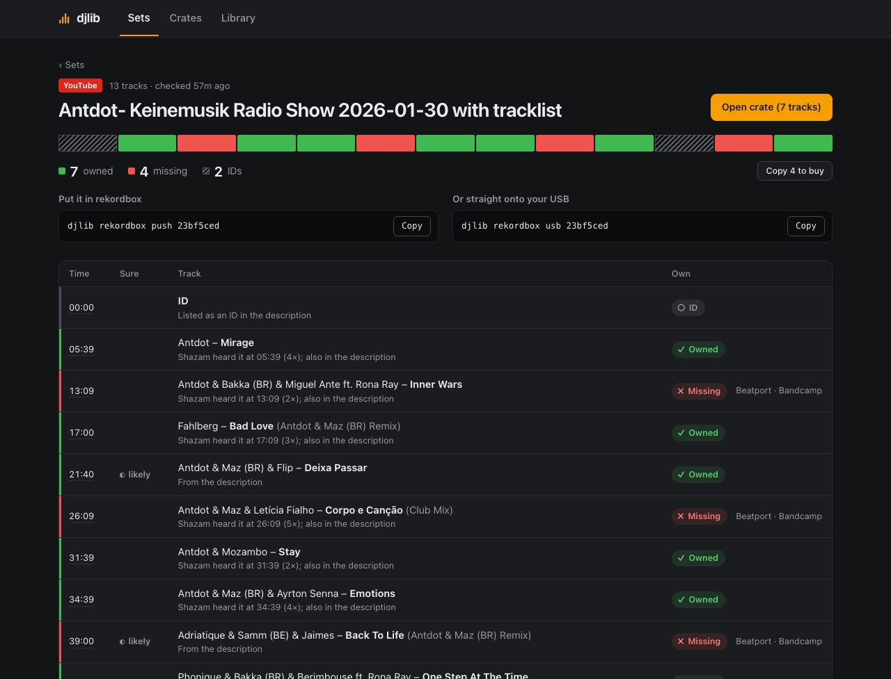

# djlib

[](https://github.com/uneasymusings/dj-library-tool/actions/workflows/quality.yml)

**Paste a set link, get every track. See what you own. Play it from your USB.**

For rekordbox DJs. Give djlib a YouTube or SoundCloud set and it finds every track: from the description, chapters, MixesDB and comments, and by running Shazam over the mix. Or start from the songs you Shazamed. djlib tells you which ones you own (the exact mix, never a lookalike), gives you a shopping list for the rest, and puts the set into a rekordbox playlist and onto your USB stick, checked track by track. It runs on your computer, with no account and no djlib server; it asks Shazam, MixesDB, YouTube and SoundCloud directly.

```text
$ djlib set 'https://soundcloud.com/platform/kaytranada-boiler-room' --no-rekordbox
✓ Kaytranada Boiler Room Montreal DJ Set  14 of 22 owned · 1 in another mix · 7 missing
  Source      SoundCloud: Kaytranada Boiler Room Montreal DJ Set
  Identified  9 heard by Shazam · 13 from tracklists only  listened 14 Oct
  Crate       ✓ 14 tracks, in set order
  rekordbox   not added yet (--no-rekordbox)
  Tracklist from MixesDB: 2013-09-27 - Kaytranada @ Boiler Room Montreal 002

The set (22)
 #  Time   Track                                                  Sure      Own
────────────────────────────────────────────────────────────────────────────────────────
 1  00:00  Kaytranada - Roots (Silent Treatment Intro)            ✓         ✓ owned
 2  01:09  Robert Glasper Experiment - Move Love (Kaytranada      ✓         ✓ owned
           Edition)
 3  03:08  KenLo Croqnote - Facteur Humidex                       ◐ likely  ✗ missing
 4  03:55  Flume - Holdin On (Kaytranada Edit)                    ✓         ✓ owned
 …
16  26:00  Bell Biv DeVoe - Poison                                ◐ likely  ≈ Radio Edit
 …
22  39:17  Modjo - Lady (Kaytranada Remix)                        ◐ likely  ✓ owned

  Owned under another spelling: #2 Robert Glasper - Move Love (Kaytranada Edition) · …

Next
  → Put it in rekordbox        djlib rekordbox push ab33dc73
  → Or straight onto your USB  djlib rekordbox usb ab33dc73
  → Your shopping list (7)     djlib requests report 7d3a8f2d
```

Real output, trimmed.

## Three ways in

```bash
djlib set 'https://youtu.be/…' --no-rekordbox   # every track in a set, and which you own
djlib shazam status                             # your Shazams, and how to check them
djlib set paste                                 # a tracklist you copied
```

Leave out `--no-rekordbox` and djlib also makes the rekordbox playlist; add `--usb` to finish on your stick. Put links in single quotes. Not on a Mac? Use a text file: `djlib set Friday.txt`.

## What it does

| You have | Run | You get |
| --- | --- | --- |
| **A set link** | `djlib set 'LINK' --no-rekordbox` | Every track in set order: time, how sure, and whether you own it. Shazam listens when the tracklist is missing, has IDs or names too few songs for the set. |
| **Your Shazams** (Mac) | `djlib shazam status` | Your Mac's and iPhone's Shazams (once Shazam syncs with iCloud), and the command to check them, last 30 days first. |
| **A tracklist** | `djlib set paste` | One “Artist - Title (Mix)” per line, copied from anywhere. From 1001Tracklists, add the set's link: `djlib set 'LINK' --tracklist paste`. |
| **Missing songs** | `djlib requests report last` | A shopping list for the set you checked last, with Beatport, Bandcamp and Traxsource searches. `djlib set 'LINK' --fetch` downloads stream-quality copies of clear matches after asking; buy the real file for the club. |
| **rekordbox and USB** (Mac) | `djlib set 'LINK' --usb` | A rekordbox playlist in set order. You click it once; rekordbox exports it, and djlib reads the stick back to check every track, in order, byte for byte. |

`≈ Radio Edit`: you own another mix. Only the exact mix goes in the crate; drag yours in if you play it. `? maybe yours`: a file with the same title and mix under another artist name, common with Shazams. It stays off the shopping list; if it's the song, pick Use this on the review page.

### How djlib drives rekordbox

- **Only its own menus.** djlib never touches rekordbox's database, and stops if the right dialog isn't in front.
- **One click for USB.** You pick the playlist; djlib checks it's the right one.
- **Your screen stays yours.** `--when-idle 60` waits until you step away.
- **Read back, not trusted.** djlib checks the stick's own library, the one CDJs load; it never writes the stick.

First time: allow the app you run djlib in under System Settings → Privacy & Security → Accessibility.

### In your browser

`djlib ui` opens a private page with your sets, crates and library; times open the set at that moment.



## Install

Paste this to Claude Code or Codex:

> Set up djlib for me by following https://raw.githubusercontent.com/uneasymusings/dj-library-tool/main/SETUP.md

Or in Terminal (Mac or Linux):

```bash
curl -LsSf https://raw.githubusercontent.com/uneasymusings/dj-library-tool/main/install.sh | sh
```

It asks where your music is and indexes it in place: nothing is moved, renamed or retagged. `djlib upgrade` updates it. Skipped the music question? `djlib init ~/Music && djlib scan`. Windows: [Install](docs/INSTALL.md).

Already have djlib? Add the Claude Code plugin with `/plugin install djlib --marketplace uneasymusings/dj-library-tool` (Claude Code 2.1.275 or later; [other ways](docs/INSTALL.md#claude-code-and-codex)).

With the plugin, just ask: “What's in this set and which tracks do I own? `https://soundcloud.com/…`”

> **Alpha (0.1.0a16).** Shazam is used unofficially: an hour-long set usually takes 5–10 minutes, up to half an hour when Shazam is busy. djlib checks the stick, not the player, so test it on a CDJ before a gig. [Limits](docs/QUICKSTART.md#limits).

## Docs

[Quick start](docs/QUICKSTART.md) · [Install](docs/INSTALL.md) · [With Claude Code or Codex](docs/AGENTS.md) · [Troubleshooting](docs/TROUBLESHOOTING.md) · [Advanced commands](docs/ADVANCED.md) · [Contributing](CONTRIBUTING.md)

MIT licensed. Bring your own music and download rights. Not affiliated with AlphaTheta/rekordbox, Shazam/Apple, MixesDB or 1001Tracklists.
