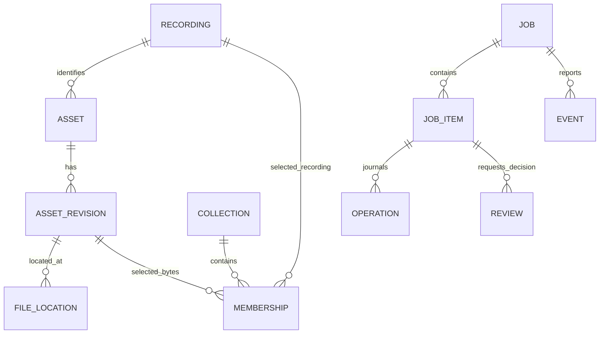
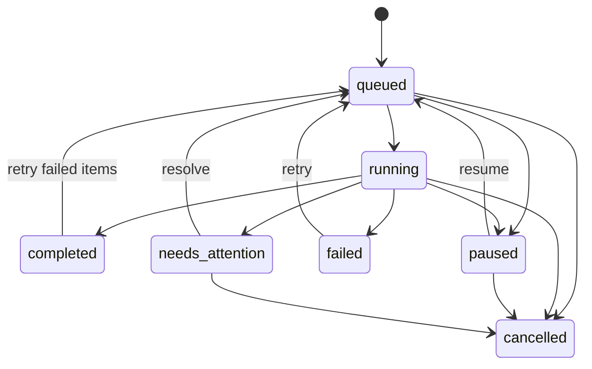

# Architecture and decisions

This document describes **0.1.0a16**, which reworks how sets are shown and entered (the whole set in set order, shopping lists, pasted tracklists, recent Shazams first, a Sets view on the review page) and adds matching under a tracklist's spelling (see the [changelog](../CHANGELOG.md#010a16)). 0.1.0a15 added set identification and Shazam history. a7–a10 added the tracklist-to-crate workflow, rekordbox automation on macOS (push, background analysis, USB export with device-library read-back) and the terminal and review-page interfaces; a6 added catalog reconciliation/discovery and durable native checks; a3 added delivery, request tracking, annotations and native snapshots to a2. Implementation, validation and publication evidence are distinguished in [status](STATUS.md).

## Execution boundary

The application is a Python modular monolith. CLI and MCP are adapters around an authenticated loopback HTTP coordinator. One coordinator holds a per-workspace file lock and owns scheduling and catalog mutations. A startup lock serializes discovery and process creation. An ephemeral port avoids hardcoded port collisions; discovery verifies a private runtime record against a token-authenticated health response and workspace/instance IDs, and (since 0.1.0a16) the workspace folder the service reports, compared on disk, so a copied workspace starts its own service instead of writing through the original's.

Windows MCP is discovery-only when no coordinator exists: it returns `COORDINATOR_START_REQUIRED`. The generated launcher starts the service before the AI host, or the user starts it from an external terminal with `service start`. This keeps coordinator lifetime outside the host SDK's Windows Job Object. No job escape or lifecycle-policy bypass is attempted. This boundary addresses the unpublished a4 candidate's confirmed cold-start lifetime defect; a6 validation is recorded separately.

Coordinator startup serializes on a 45-second lock and waits up to 30 seconds for authenticated health. One attempt spawns at most one child. Lock contention, an exited child without a healthy service, and an alive child without readiness return distinct busy/failed/timeout errors. A timeout does not kill the startup process or submit the caller's requested music operation; inspect status/logs before retrying.

The coordinator runs a FastAPI/Uvicorn event loop. Database transactions are short and synchronous. Within durable jobs, blocking audio decoding, hashing, and file copies run in threads without a database session. Organization, passed analysis/native-export observations and app verification use per-item jobs; individual metadata/annotation operations and bounded request-ledger checks remain synchronous. yt-dlp runs as an isolated subprocess with bounded metadata output, timeouts, and a staging-growth monitor. Client exit does not own job cancellation.

There is one active worker per workspace. Item-boundary requeueing provides fair scheduling across waiting jobs; persisted queue timestamps preserve peer ordering across restarts. A bounded preference keeps handoff work responsive without indefinitely starving acquisitions. Set identification runs in its own runner beside the worker (below), so listening to a set never holds up scans or downloads. Parallel provider workers and provider-specific concurrency limits remain future work.

## Code map

| Package | Responsibility |
| --- | --- |
| `domain` | Strict public input contracts, label normalization, typed failures. |
| `application` | Plans, job submission, idempotency, review decisions, collection/catalog queries, set identification (`identification.py` runs it, `set_identification.py` merges it). |
| `persistence` | SQLAlchemy models, Alembic migration history, transactions. |
| `jobs` | Worker, state checkpoints, generation fencing, ingestion journal, export preparation. |
| `audio` | Complete decoding, measured properties, byte hashes, embedded labels, short WAV windows cut from a set for recognition. |
| `sources` | Optional web metadata, selected-download adapter, song recognition (Shazam, AudD, ACRCloud) and Shazam history readers. |
| `exporting` | Atomic handoff documents, isolated app working copies, documented hardware profiles, and bounded read-only device inspection. |
| `interfaces` | JSON CLI, MCP client adapter, loopback server/client lifecycle. |

## Catalog model

A named recording identity is a conservative normalized artist/title/version tuple. New incomplete-label indexing uses provisional byte identity, and symbol-only distinctions are preserved. Existing incorrect merges are not automatically repaired. Neither form is an acoustic fingerprint. A byte revision has a unique SHA-256 hash and immutable measured properties. File locations and collection membership are independent, so identical bytes can be reused without copying. New indexing retains a decoded-payload baseline for explicit tag-only reconciliation, not for acoustic song recognition.

Collection membership chooses one revision per recording and does not automatically choose a better edition. If several locations exist for those bytes, exports prefer managed storage. Missing locations remain visible with unavailable evidence. Catalog/saved-work listing uses query-bound keyset cursors and an insertion cutoff; metadata and location state remain current rather than transaction-frozen. Quality-based upgrade selection remains future work.

Explicit reconciliation pins a catalog revision and the changed path's new SHA-256. `tag_only` requires unchanged decoded payload and stream format, keeps recording/asset identity and adds a byte revision. Legacy revisions need a baseline or another verified original-byte location. `replace_audio` uses exact known bytes or a new provisional identity. Neither mutates audio or transfers prior annotations/memberships to the new revision. Old location history is retained; affected request matches and delivery evidence are invalidated, and historical export receipts gain a stale marker rather than being rewritten.

Web assets retain source URL, conversion evidence, unverified source quality, and unverified acoustic identity. Selected downloads are saved as MP3 (copied when the source already is MP3) and receive the chosen artist/title/version tags on a staged managed copy; full decoding and hashing run again before that copy is promoted. The acquisition bytes remain unchanged in `incoming/`, with their hash retained in provenance. Generated tags are supplied display labels, not independent identity evidence. External user files retain their source path and original tags.

## Durable jobs

`completed` carries either `complete` or `completed_with_gaps`. A job can be complete with failed/skipped items; the assistant must examine outcome and counts. Empty scans complete with no tracks. Review decisions are revision-checked. Cancellation is terminal and preserves accepted assets; a new intent is needed to restart cancelled work.

The diagram's retry transition is not universal. Committed annotation/organization transactions and completed organization jobs are terminal. A delivery-check job that committed evidence is terminal even when that evidence records failure. Read the current delivery/annotation revision and submit a new explicit intent instead of reopening committed history.

Idempotency is scoped to the workspace. A key stores a semantic request hash and the accepted job ID in the same transaction. Repeating the exact request returns that job; reusing its key with another request returns a conflict. Request lists have one opt-in exception (`same_list`, used by the CLI's `set` and `requests create`): a new key whose list has the same name and the same songs in the same order as a saved one updates that list's inputs in place, keeping item IDs and choices, so a set checked again with different notes (by a newer djlib, say) keeps its crate and playlist. A song is its normalized artist, title and version and an ID only its position; a list of IDs alone is found only by its key. MCP and plain API calls keep strict key replay. Collection starts include the plan ID and frozen profile. Export requests freeze the current collection, so a changed collection requires a new export key.

Every attempt has a generation number. Pause/cancel/retry advances it, and later worker commits check the job state and generation. On service restart, running items become pending. Managed destinations use the revision hash, allowing a retry to reconcile a file promoted before a catalog commit. The operation journal records planned/staged/committed/failed phases; it is not yet a general rollback engine.

## Set identification

An `identify` job names the songs in one YouTube or SoundCloud set. `IdentifyRunner` (`application/identification.py`) starts with the coordinator after the worker, listens to one set at a time (a second lane shows sets identified before, so they never wait for a listen that Shazam's rate limits stretch to an hour; each set has one job at a time), and resumes jobs a restart requeued; the worker never claims identify jobs and doesn't yield to them. Each slow step (reading the page, downloading, listening) runs as a task that is cancelled when the job's state or generation changes, so pause and cancel take effect within about half a second. A transient database error doesn't end the runner, and a failure the catalog can't record yet (a full disk) is recorded once it can.

The runner reads the page (description, chapters, up to 1,000 comments) and looks the set up on MixesDB (`sources/mixesdb.py`, through its open MediaWiki API, with at most four requests per lookup started at least 4 seconds apart across all lookups, as its robots.txt `Crawl-delay` asks; a page counts only when it links the same upload, or names the same DJs and event with an agreeing day or length; a doubtful page or an outage is no tracklist, never an error), keeps both in the set's `page.json` (a job that resumes, or a new run within the hour, reuses it; comments that take too long are skipped with a notice), checks there is room for the audio and its decoding, downloads the set's audio with yt-dlp into the set's folder, cuts a 12-second WAV window every 30 seconds (every minute when a tracklist of five or more songs times most of its lines, which halves the requests; the spacing is kept in the job's result, so a resume keeps it) and asks the recognizer about each. FFmpeg decodes the set once, in the background, to 16 kHz mono PCM beside it; windows are cut from that to the sample, and the next window is cut while the recognizer hears the current one, so requests stay one at a time at the recognizer's pace. A window the decoding can't serve (it failed, stalled, is far behind or wouldn't fit on the disk) is cut by FFmpeg on its own; a decoding that hits a full disk is deleted at once. Every answer is appended to `probes.jsonl` the moment it arrives, so a paused, cancelled, interrupted or rate-limited identification resumes with the windows it hasn't heard yet (failed windows are asked again), and later tracklists merge without the audio. Ten failed windows in a row, or failures on more than a quarter of the set, end the listen with `RECOGNITION_FAILING` instead of a tracklist made from nothing; Shazam answering 401, 403 or 404 ends it at once (`RECOGNIZER_REJECTED`). A second pass spends up to half as many windows again where neighbouring windows disagree or failed, to place song changes. Shazam (through shazamio, unofficial) is paced one request per second per process and backs off from 5 seconds, doubling up to 40 seconds, when rate-limited, giving up after about 15 minutes of waiting with `RECOGNITION_RATE_LIMITED`, and the job's progress says while it waits; AudD scans whole files and ACRCloud signs each request, both with the user's keys. The audio is deleted once the tracklist is made, or after a failure no retry can fix; what a paused, cancelled or failed listen leaves behind goes once nothing used it for a day. A download is yt-dlp's (resumed after an interruption; one still running from a service that was killed is stopped first), is tried once more after a short pause when the site fails it (`SOURCE_FAILED`: YouTube refuses about one set download in five on the audio's first request, and yt-dlp gives up on any 4xx at once), fails when pieces of it can't be fetched (yt-dlp's “fragment N not found”, also a retryable `SOURCE_FAILED`, so that is tried once more too) or it stops growing for five minutes, and one that comes out short of the page's length is listened to with the rest counted as unheard. Each failed try is noted in `runtime/downloads.log` with yt-dlp's last error lines, cleaned of links, cookies and the home folder (`web.error_lines`); they ride on the error as its notes and never reach a message or a JSON envelope. An `--again` listen moves the earlier result to `previous/` and deletes it only when the new one is made; until then the earlier result is what `finished` returns and what a plain run reuses. A reused identification takes the page `djlib set` read a moment ago (a tracklist may have been added since), reads a page older than a day again, and asks MixesDB again when the last lookup failed or found nothing a day ago.

`set_identification.build_tracklist` is pure: it groups windows into songs heard (a song heard in one window is never a track on its own), aligns each listing (given tracklists, then the description, then chapters that don't repeat it, then MixesDB's) to them in order, so a listed song takes the heard song's time (or its listed time, when that is at most a stride and a window before the first window that heard it and after the song before) and keeps its own label, and gives listed songs nobody heard a time between neighbours (`approx`). A listed line that matches a heard song only with artist and title swapped (a “Title - Artist” listing) is read the other way round first; djlib does not guess the order of lines nobody heard. The heard label wins only when two or more windows heard the same title with the same credited names, some spelt differently (“Armand Val Helden” listed, “Armand Van Helden” heard): the library check compares names exactly, so a misspelt listing would hide files the DJ owns; the other spelling stays in the track's `also_named` and its notes. Since 0.1.0a16, a `confirmed` track whose shown label took the heard spelling also passes the listing's credits to its request item as `also` (with the heard title and mix), and request matching tries that spelling only when the shown one owns nothing, by the same exact rule, so a file tagged the way the tracklist spells the song counts as owned and a different mix never does. Names match across spellings (same words with nearly the same letters, or a name of two or more words that starts the other: “Robert Glasper” and “Robert Glasper Experiment”), and “X” separates credits like “x” and “&”. IDs that two listings place between the same songs (within five minutes of each other, or untimed in either, as MixesDB's “[4?] ?”) are one ID. Songs heard in two or more windows that no listing names fill the nearest listed ID, contradict a listed song there (`conflict`) or become tracks of their own; the listing says what plays, so a stretch where nothing was heard belongs to the track before it, and only an opening of three minutes or more that the listing leaves out becomes an ID. Without a listing, stretches of three minutes or more where nothing was heard become IDs, unless the song before them is heard again after them, and so do stretches of 90 seconds or more where a listener names another song; an ID longer than two of the set's songs (median length) says about how many it holds (`songs_estimate`). A single window naming the song before or after it is that song; windows whose song offset is out of line still place a song but don't count towards its strength. `coverage` keeps named seconds (`seconds_identified`) apart from heard ones (`seconds_heard`), and `gaps` are the stretches of 90 seconds or more where no song was heard. Listener comments only add candidates, never the song just before or after the ID; a song heard once that a listener also named within a minute of it ranks first among an ID's candidates heard once. Each track carries its evidence and a status (`confirmed`, `likely`, `weak`, `conflict`, `unidentified`); an ID's likely song is a candidate, never its label. The result is saved as `tracklist.json` and `tracklist.txt`, which `djlib set FILE` reads; `djlib set LINK` builds its request list from it, IDs staying unknown items.

Shazam history (`sources/shazam_history.py`) runs in the CLI or MCP process, not the coordinator: it copies the Mac's Music Recognition database (or an iPhone backup's, a CSV, or Apple Music's playlist) with its write-ahead log, opens the copy read-only and discovers Core Data columns at run time, because Apple changes them between releases. What was imported is remembered in the workspace's `shazam.json` (since 0.1.0a16 also the crate, the list holding the newest Shazams, and the rest of a list cut at 1,000), so `shazam:new` and `shazam status` know what comes next.

Tracklists come in as files, as `paste` (macOS `pbpaste`) or as `-` (stdin), all read in the CLI process. Text is decoded as UTF-8, UTF-16 with a BOM or cp1252, and RTF goes through macOS `textutil`; a CSV or TSV is Shazam's export (read as Shazams) or, with Artist and Title columns, a song list. The parsed list then takes the same `POST /requests` path as a file.

## File boundaries

Workspaces have explicit allowed source roots. Additive root updates validate existing directories and preserve prior permissions; since 0.1.0a16, `init FOLDER` on an existing workspace adds new folders through the same additive update (it used to reject them with `ROOTS_NOT_UPDATED`). Source symlinks resolve before authorization. Managed media and handoff documents use predictable IDs/hash names; publisher strings never become filesystem paths. Original sources are reused unless the selected profile copies them.

Web sources are public HTTPS YouTube, SoundCloud and Bandcamp links only: SoundCloud's embed players and any link whose query carries another address are refused, `on.soundcloud.com` short links are resolved by djlib (one request, no redirect followed, the answer must be on soundcloud.com), and yt-dlp runs only its YouTube, SoundCloud and Bandcamp extractors (`--use-extractors`), never the generic one that fetches any address. Text from set pages, comments, MixesDB, Shazam exports and tracklist files loses its control characters and direction marks where it enters djlib, and the terminal drops any that remain, so an escape sequence never reaches the screen. Merging a set's tracklists runs in a thread and reads at most 400 tracks per listing; tracklist files are at most 1 MB, Shazam CSVs 50 MB and databases 1 GB, and devices are refused.

Audio inspection streams complete WAV payloads, or uses ffprobe plus bounded full FFmpeg decoding for other supported formats. Source size/mtime is checked around inspection. Copies are hashed before atomic promotion. Export hashes are checked again before artifact generation. These measures detect changed bytes, but do not prove authenticity, lossless origin, or acoustic identity.

## rekordbox automation (macOS)

rekordbox steps run in the CLI process, never in the coordinator: macOS grants UI control to the user's terminal (Accessibility), and the coordinator stays a headless service. `src/djlib/native/rekordbox_mac.py` drives rekordbox only through its menus and dialogs with AppleScript/System Events: File > Import > Import Playlist (an M3U8 of original files, so existing analysis and cues are reused), File > Export Collection in xml format, and Playlist > Export Playlist > *device*. Dialogs are filled through accessibility values and named buttons; the few keystrokes are sent only after checking that rekordbox is frontmost and the expected dialog has focus, otherwise the dialog is cancelled. A locked screen is detected and waited out. rekordbox's database is never opened.

rekordbox's browser is a custom canvas with no accessibility tree, so playlist selection cannot be scripted. For USB export the user clicks the playlist; djlib reads the selection from the prefilled name in Playlist > Export a playlist to a file (then cancels) and only exports when it matches. Completion is read from the stick (every expected file present and nothing changing), not from rekordbox's in-window progress.

Read-back is the evidence. Pushes are confirmed from rekordbox's playlist menu or one XML export. USB exports are confirmed by parsing the stick's `PIONEER/rekordbox/export.pdb` read-only (`src/djlib/exporting/rekordbox_pdb.py`, DeviceSQL pages and row groups for tracks, keys, artists, playlist tree and entries) and hashing each entry's file against the frozen manifest, in order. BPM and cue counts come from rekordbox's `ANLZ0000.DAT` files (`rekordbox_anlz.py`), synced incrementally by the coordinator every two minutes once enabled. The CLI records what it pushed and verified per collection in `exports/rekordbox/history.json` for `status`.

## Target delivery and the native app boundary

`Delivery` persists a request, collection/recording snapshot, preparation job, revision and evidence. `rekordbox_import` and `serato_import` need no hardware or USB. Separate `rekordbox_usb` and `serato_portable` track device delivery; only standalone rekordbox USB requires a documented player profile. The app version and audio mode are part of the request. Pilots sample collections round-robin. Full local preparation may omit a pilot with explicit unvalidated status; a supplied pilot must match and pass. All readiness gates remain. Pilot/full copies use separate paths with no native cue/history reuse. See [DJ delivery](DJ_DELIVERY.md).

Preparation runs through durable jobs and writes separate working audio, M3U8 membership lists, a hash-checked delivery manifest and native instructions inside the workspace export directory. Original catalog files remain unchanged. Preservation is the default; MP3 or WAV compatibility conversions require an explicit mode. Plans freeze explicit annotation values/revisions in `dj_metadata`; preparation writes supplied BPM/key/genre and descriptive comments to working copies while the manifest retains provenance. Fractional MP4 BPM uses an exact freeform value rather than rounding the integer tempo field, with a native-display warning. Writing supplied tags does not perform acoustic analysis. Full decoding, measured format checks and hashes establish preparation, not native app import or player compatibility.

Native app actions belong to rekordbox or Serato. The engine does not implement a native export CLI, synthesize native crates/device databases, or write to the bound USB. Typed operator observations record `imported`, `analyzed`, `native_exported`, `device_library_checked`, and `hardware_playback` in order. Passing observations must cover frozen recording IDs and playlist counts; full hardware playback may use an explicitly reported sample. Revision checks prevent stale updates, but do not independently authenticate the operator's claims. Replacing earlier evidence or rebinding a device invalidates dependent evidence.

Read-only native rekordbox XML inspection compares a supported Collection export with exact prepared paths and playlist membership/order. It checks the declared product version, reports raw BPM/key and unknowns, and never changes delivery evidence/readiness or opens referenced media. Bounded snapshot parsing is separate from live native state, musical accuracy and device verification. Operator annotations may explicitly cite the snapshot checksum/version; this is not `native_tag` evidence from catalog originals.

App-only workflows require the first two native observations plus `verify-app`, which rechecks working audio and refreshes the recorded post-analysis file hashes. Completion returns a delivery ID/revision/evidence-commit receipt, never `ready_for_app_use`. Saved delivery status exposes `app_requirements_met_at_last_check` and the app-readback timestamp; it does not rehash files or imply USB readiness. App input format profiles are separate from player profiles. Serato's documented format families are paired with explicit conservative engine bounds, not invented vendor sample-rate maxima.

Passing rekordbox hardware observations also require a matching `hardware_profile`, an actual `firmware_version`, and `storage_recognized: true`. The CDJ-3000 profile rejects withdrawn firmware 3.30 after whitespace/case/optional `v` normalization. These are validations of operator-supplied evidence, not direct hardware queries.

Analysis reconciliation is limited to isolated working copies. Matching whole-file hashes take a fast path; changed copies undergo fresh stream-property and decoded-PCM hash checks before post-analysis hashes are accepted. Passed analysis/native-export observations and app verification queue per-track jobs; intent-derived keys make retries stable. Native-export checks require exact analyzed bytes and validate the bound volume at acceptance and finalization. Deferred finalization rechecks file identity signatures and atomically fences evidence/revision updates against job generation, pause and cancellation. Saved completed receipts identify committed evidence; the delivery retains its check time, not ongoing freshness. This does not parse native analysis; explicit catalog reconciliation is a separate operation.

Device inspection reads mount/identity metadata and bounded audio hashes without following symlinks, Windows reparse points or nested volumes. POSIX traversal uses descriptor-relative no-follow opens; Windows uses relative native opens beneath held directory handles. File observations use comparable path/handle identities, with no timestamp-only fallback. Native database names are existence markers, never parsed integrity or playlist evidence. Stronger volume identities use macOS `diskutil` or the Windows mount manager's volume GUID; failed queries and other platforms retain a weak fallback, insufficient for the readiness gate. Windows filesystem names and MBR/GPT partition style can be queried through a bounded metadata-only native child process; unsupported or failed partition queries preserve known volume GUID/filesystem evidence and leave the style unknown. FAT/exFAT legacy identity handling is conservatively guarded; runner tests do not establish physical USB compatibility. Limits, scan failures and missing hashes are reported. The status endpoint does not rehash: fresh departure evidence comes from explicit `verify-device` and remains conditional on operator reports and hardware sampling.

Hardware profiles carry primary-document references, exact known format limits, explicit unknowns, and false firmware/hardware-verification flags. The engine conservatively assesses only known mono/stereo channel counts and checks a supplied output extension against the codec's supported suffixes. Those checks do not validate every container header or establish an exhaustive manufacturer channel-layout limit. Their assessment is not a player certification. OneLibrary/Device Library selection follows [AlphaTheta's export guidance](https://cdn.rekordbox.com/files/20260318114024/OneLibrary-Compatible-USB-Device-Export_en.pdf); portable Serato copying follows the [native Files/crate workflow](https://support.serato.com/hc/en-us/articles/202304844-Using-a-USB-external-hard-drive-for-your-portable-library). Neither is replaced by generic audio copies or interchange XML.

## Decisions

| Decision | Reason and consequence |
| --- | --- |
| Existing LLM host first | Delivers conversational use without maintaining model credentials, an agent loop, or a frontend. A standalone chat adapter remains planned. |
| CLI + MCP share HTTP use cases | Both clients see the same accepted jobs and typed contracts. Coordinator lifecycle is additional operational complexity. |
| One workspace, several profiles | Preferences don't split catalog identity or create multiple writers. |
| SQLite + Alembic | Easy local ownership and versioned migration history. Schema upgrades first save integrity-checked catalog backups; automatic restore and broader media/native backups remain outside scope. |
| SQLite DELETE journal | A single scheduler does not need WAL; avoids platform-specific WAL handling. Multiple remote users are outside this release's model. |
| Byte hashes and versioned identity | Distinguishes duplicate files from requested recording versions; acoustic fingerprints of owned files are a separate later capability. Set identification recognizes a set's songs, never the user's files. |
| Listen in windows, merge with text | Recognition services name one song per short window and DJ mixes overlap, so audio gives times and published tracklists give labels; only the audio makes a track `confirmed` (heard where a listing names it, or in three or more windows), since listings copy each other. Saved windows make identification resumable and repeatable without listening again. Shazam needs no account but is unofficial; AudD and ACRCloud are licensed alternatives. |
| yt-dlp as optional subprocess | Keeps provider churn and dependencies away from core installation. Public-source extraction can still break or be unavailable. |
| App-owned native delivery | Isolated artifacts and explicit evidence support supervised native app work. Device hashes cannot prove playlist references or physical playback; native actions remain outside the engine. |
| Drive rekordbox through its menus | Works with every rekordbox 6/7 library without reverse-engineering its encrypted database or risking it. Costs a few seconds of screen time per push and one user click per USB export; `--when-idle` and background analysis keep the rest off screen. |
| Verify by reading back | Pushes and USB exports are checked from rekordbox's own outputs (menu, XML, the stick's `export.pdb` and file hashes) rather than assumed from having clicked. Player playback still needs a human. |
| Terminal views and a local review page, no hosted frontend | Product effort goes to the CLI, MCP tools and actual DJ workflow reliability; `djlib ui` serves a private page from the same coordinator. The page builds its views (set strips, store searches, listen links) from the existing routes; the only server-side addition for it is `counts` on saved-set rows, shared with `djlib requests` and MCP. |
| Upgrades finish in the new djlib | `uv tool install` replaces the running environment, so after the install the old process imports nothing and runs the installed djlib (`upgrade --finished-from`, hidden) to sync the plugin, restart the service and reply. Every later release must keep accepting that option, because older releases call it. |

The XML writer follows [AlphaTheta's published interchange format](https://cdn.rekordbox.com/files/20200410160904/xml_format_list.pdf), including its explicit `file://localhost/` location convention. Remote/UNC locations must first be copied into local managed storage. Format conformance is not app compatibility evidence.

## Known engineering gaps

Native target-delivery trials are outstanding; runtime evidence is tracked in [status](STATUS.md). Integrity-checked catalog backups precede schema upgrades, but automatic restore is not implemented. Remaining gaps include staging garbage collection, automatic expired-service log rotation, provider rate-limit scheduler, filesystem power-loss durability proof, deterministic cancellation of in-flight threads, audio fingerprints of owned files, a live listen with the 0.1.0a16 build, or live DJ database adapters. SQLite catalog hashes become stale when a user retags an external file; export rejects that file and asks for reconciliation. Explicit catalog reconciliation is implemented with conservative revision/history boundaries; it does not automatically repair historical identity merges, migrate old annotations/memberships, or choose quality upgrades. The [plan](../PLAN.md) specifies the full release gates.
